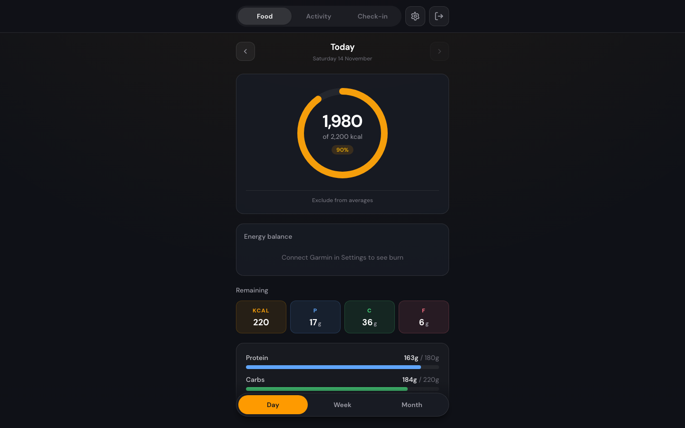
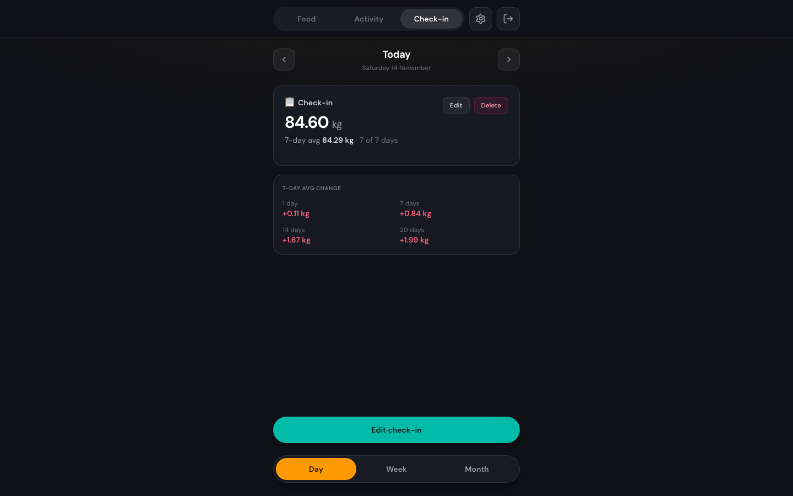
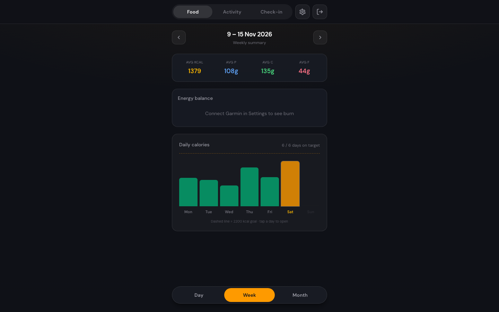
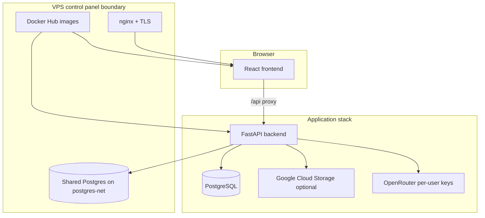

# Health Tracker

Personal nutrition tracker with AI food estimation, daily check-ins, and activity dashboards. Log meals and macros, review progress over a day or week, and record weight without relying on production data or live Garmin feeds.



## Overview

Health Tracker is a full-stack web app for tracking food, body-weight check-ins, and (eventually) Garmin-style activity views. The React dashboard talks to a FastAPI backend backed by PostgreSQL. Per-user OpenRouter keys and optional cloud photo storage stay server-side.

Research notebooks under `notebooks/` explore Garmin and vision APIs; they are separate from the main product UI.

## Features

- **Food** — log meals, track macros, AI photo/text estimation, day/week/month dashboards
- **Check-in** — daily weight and progress photos with weekly trends
- **Health** — activity-oriented views (UI stub; live Garmin sync is not wired to production yet)
- **Settings** — per-user OpenRouter models and optional Garmin/Hevy integrations

## Screenshots

| Food day | Check-in | Week view |
|----------|----------|-----------|
|  |  |  |

## Architecture



**Standalone path** — `docker-compose.standalone.yml` runs Postgres, backend, and frontend on one machine. The frontend is published on all interfaces; the API binds to loopback for local docs and debugging.

**Control panel path** — `docker-compose.yml` is the production contract: prebuilt images, no bundled Postgres, join external `postgres-net`, and bind host ports to `127.0.0.1` only. The [VPS control panel](https://github.com/andrewallkin/vps-control-panel) supplies production `POSTGRES_*`, image tags, TLS, and health checks. This repository does not contain nginx or host TLS configuration.

Authentication uses JWT cookies on `/api/auth/*`. Meal and check-in photos use optional GCS; local dev can use filesystem storage under `data/`.

## Technology stack

| Layer | Technology |
|-------|------------|
| Frontend | React 19, Vite, TypeScript, Tailwind CSS, React Router |
| Backend | Python 3.11, FastAPI, SQLAlchemy, Alembic |
| Database | PostgreSQL 15 |
| Auth | JWT access/refresh cookies, bcrypt passwords |
| AI | OpenRouter (per-user API keys, encrypted at rest) |
| Containers | Docker Compose (dev, standalone, panel) |

## Getting started

Requires Docker, [uv](https://docs.astral.sh/uv/) (Python 3.11+), and Node.js 20+ if you run the frontend outside Compose.

```bash
uv sync --all-packages --all-groups
cp .env.example .env
```

Generate `ENCRYPTION_KEY`:

```bash
python -c "from cryptography.fernet import Fernet; print(Fernet.generate_key().decode())"
```

Start the dev stack (hot reload + bundled Postgres):

```bash
docker compose -f docker-compose.dev.yml up --build
```

Apply migrations (from the repo root, with `.env` pointing at the dev database):

```bash
./backend/run_migrations.sh
```

Optional synthetic demo data:

```bash
uv run python scripts/seed_db.py --reset
```

Open **http://localhost:3000** and sign in with **`demo@example.com`** / **`password123`**, or register at `/register`.

## Configuration

See [`.env.example`](.env.example) for the full variable list. Highlights:

| Variable | Purpose |
|----------|---------|
| `POSTGRES_*` | Database connection (`POSTGRES_HOST=postgres` for dev and standalone) |
| `ENCRYPTION_KEY` | Fernet key for stored OpenRouter and Garmin secrets |
| `JWT_SECRET_KEY` | Auth token signing |
| `CORS_ORIGINS` | Allowed browser origins in development |
| `GCP_SERVICE_ACCOUNT_CREDENTIALS`, `GCS_IMAGES_BUCKET_NAME` | Production photo storage |

## Deployment

- **Local development** — `docker compose -f docker-compose.dev.yml up --build`, then `./backend/run_migrations.sh`.
- **Standalone** — `docker compose -f docker-compose.standalone.yml up --build`, migrate in the backend container, seed demo data; no control panel required.
- **This VPS** — the control panel runs `docker-compose.yml` in image mode against shared Postgres.

Full steps: [`docs/deployment.md`](docs/deployment.md).

## API

All JSON routes are under `/api`. Interactive OpenAPI docs (when the backend is reachable on loopback):

- **Swagger UI** — http://127.0.0.1:8000/docs
- **ReDoc** — http://127.0.0.1:8000/redoc

Representative routes:

| Area | Examples |
|------|----------|
| Auth | `POST /api/auth/login`, `POST /api/auth/register`, `POST /api/auth/logout` |
| Food log | `GET /api/entries`, `POST /api/entries`, `GET /api/meals`, `POST /api/estimate` |
| Check-ins | `GET /api/check-ins`, `POST /api/check-ins` |
| Health views | `GET /api/health/day`, `GET /api/health/week` |
| Liveness | `GET /health` (no `/api` prefix; used by production health checks) |

External REST surface for scripts: `/api/external/*` (see `/api/external/docs` when authenticated).

## Development and tests

**Backend tests**

```bash
uv run --project backend pytest
```

**Frontend checks**

```bash
cd frontend && npm ci && npm test && npm run lint && npx tsc -b
```

**Screenshot capture** (after standalone stack is up, migrated, and seeded):

```bash
npm install
npx playwright install chromium
node scripts/capture-screenshots.mjs
```

Writes `docs/images/hero.png`, `feature-01.png`, and `feature-02.png` at viewport 1440×900. Uses demo credentials **`demo@example.com`** / **`password123`** on a freshly seeded database only.

Optional local backend without the Compose frontend:

```bash
uv run --project backend uvicorn backend.main:app --reload --port 8000
cd frontend && npm run dev
```

Vite dev server: **http://localhost:5173** (proxies `/api` to port 8000).